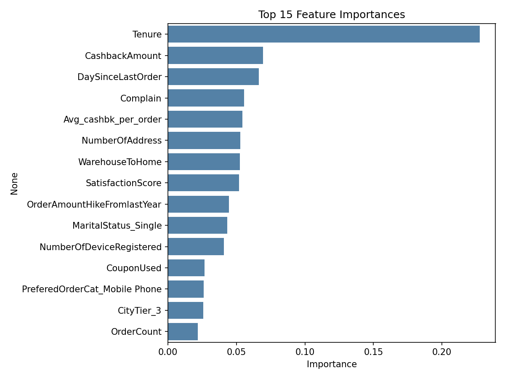
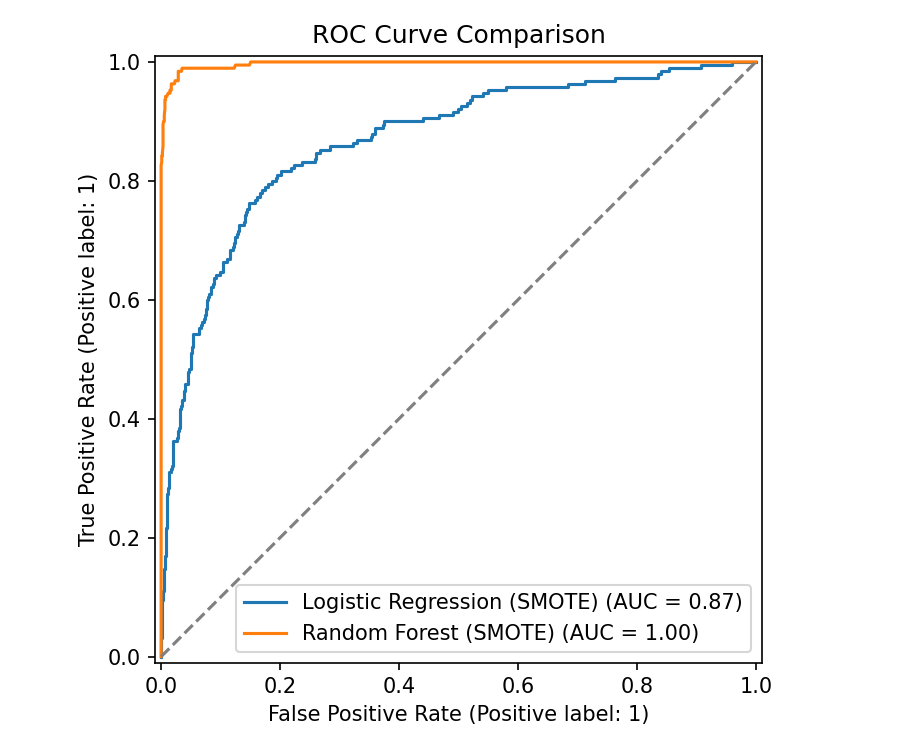
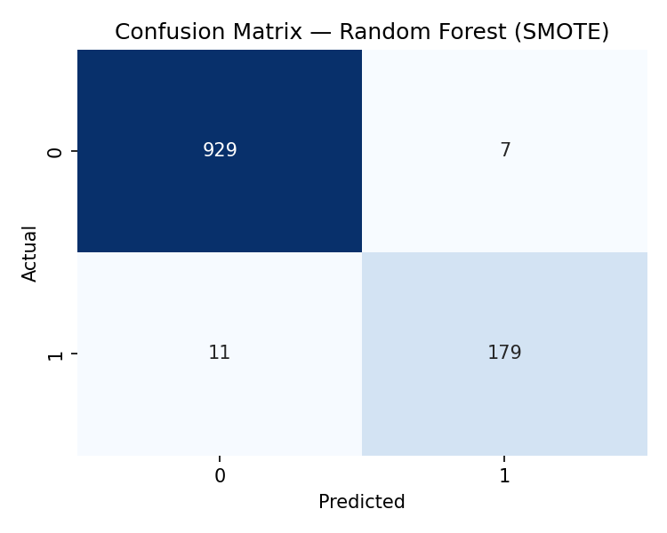

# E-Commerce Customer Churn Prediction

Predicting which customers of an online e-commerce platform are likely to churn, so the business can target retention efforts where they matter most.


## Overview

Customer churn is one of the most expensive problems for a subscription or repeat-purchase business — acquiring a new customer typically costs far more than retaining an existing one. This project builds an end-to-end machine learning pipeline that:

- Cleans and explores a real e-commerce customer dataset (5,630 customers, 20 features)
- Engineers features and handles severe class imbalance (~17% churn rate)
- Trains and compares Logistic Regression and Random Forest classifiers
- Evaluates using precision, recall, F1, and AUC-ROC (not just accuracy, which is misleading here)
- Identifies the strongest drivers of churn for the business to act on

## Results

| Model | AUC-ROC | F1 (churn class) | Precision | Recall |
|---|---|---|---|---|
| Logistic Regression (SMOTE) | 0.868 | 0.600 | 0.492 | 0.768 |
| **Random Forest (SMOTE)** | **0.997** | **0.952** | **0.962** | **0.942** |

The Random Forest model correctly identifies **94% of customers who actually churn** while keeping false positives low, and is saved as the production model in `models/churn_model.pkl`.

**Top churn drivers (feature importance):**



`Tenure` dominates — newly acquired customers churn at far higher rates than long-tenured ones — followed by `CashbackAmount`, `DaySinceLastOrder`, and whether the customer has filed a `Complain`.

<details>
<summary>ROC curve & confusion matrix</summary>




</details>

## Business Recommendations

- **Focus retention on new customers.** Tenure is the single strongest churn signal — the first weeks/months of the relationship are the highest-risk window.
- **Fast-track complaint resolution.** Customers who complain churn at a notably higher rate; quick resolution is likely a high-leverage retention lever.
- **Use cashback and order-recency as win-back triggers.** Customers earning less cashback per order or who haven't ordered recently are good targets for proactive outreach or a promotional nudge.

## Project Structure

```
ecommerce-churn-prediction/
├── data/
│   └── raw/                      # place E_Commerce_Dataset.xlsx here (not tracked in git)
├── notebooks/
│   └── customer_churn_analysis.ipynb   # full EDA + modeling walkthrough, with narrative
├── src/
│   ├── data_preprocessing.py     # cleaning, feature engineering, encoding
│   └── train.py                  # end-to-end training script (CLI-runnable)
├── models/                       # saved model, scaler, feature list, metrics.json
├── reports/figures/              # generated plots
├── requirements.txt
└── README.md
```

## Getting Started

```bash
git clone https://github.com/<your-username>/ecommerce-churn-prediction.git
cd ecommerce-churn-prediction
pip install -r requirements.txt
```

Download the dataset ([E Commerce Dataset on Kaggle](https://www.kaggle.com/datasets/ankitverma2010/ecommerce-customer-churn-analysis-and-prediction)) and place `E_Commerce_Dataset.xlsx` in `data/raw/`.

**Run the full pipeline from the command line:**
```bash
python -m src.train
```
This retrains both models, prints evaluation metrics, and saves the best model plus figures to `models/` and `reports/figures/`.

**Or explore the analysis interactively:**
```bash
jupyter notebook notebooks/customer_churn_analysis.ipynb
```

## Methodology Notes

- **Missing values** are imputed per-column with the median (numeric columns only).
- **Outliers** are capped using the IQR (winsorizing) method rather than dropped, to preserve sample size.
- **Class imbalance** (~1 churner for every 5 retained customers) is addressed with SMOTE oversampling on the training set only — the test set is left untouched to give an honest performance estimate.
- **Evaluation** deliberately reports precision/recall/F1/AUC-ROC per class instead of leading with accuracy, since a model that always predicts "no churn" would still score ~83% accuracy while being useless.

## Tech Stack

Python · pandas · NumPy · scikit-learn · imbalanced-learn (SMOTE) · matplotlib · seaborn · joblib

## Dataset

[E Commerce Dataset](https://www.kaggle.com/datasets/ankitverma2010/ecommerce-customer-churn-analysis-and-prediction) (Kaggle). Not redistributed in this repo — see `data/raw/README.md` for download instructions.

## License

MIT — see [LICENSE](LICENSE).
