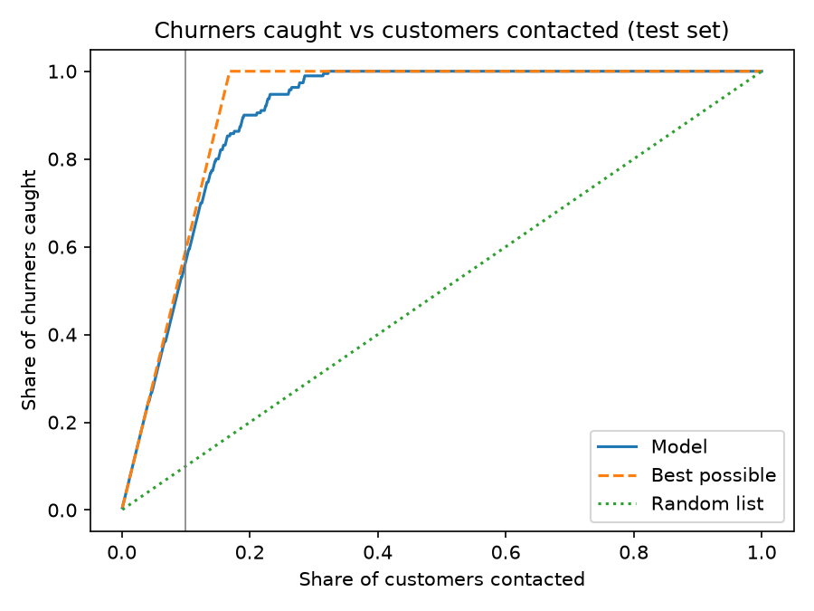

# E-commerce Customer Churn Prediction

A retention team can only contact about 10% of its customers. Which ones should it contact first?

## Result

I tested the model on 1,126 customers it never saw during training. 190 of them churned. The 112 customers the model ranks highest (the top 10%) include **107 real churners**. That catches 56% of all churners. No list of 112 customers could catch more than 59%.

| | Logistic regression (baseline) | Final model (gradient boosting) |
|---|---|---|
| ROC-AUC | 0.873 | 0.982 |
| Churners found in the top 10% list | 90 of 190 (47%) | 107 of 190 (56%) |
| Real churners among the 112 contacted | 90 of 112 | 107 of 112 |

On this one test set, the ROC-AUC could plausibly range from 0.976 to 0.988 (bootstrap, 500 resamples).



The blue line is the model. The dashed line is the best any list could do. The dotted line is a random list.

## Why not accuracy?

About 17% of customers churn. A model that says "nobody will churn" is right 83% of the time and finds zero churners. So I look at the top-10% list instead, because that's the decision the retention team actually makes.

## How I tested it

My first version of this project reported a ROC-AUC of 0.997. That number was too good, so I rebuilt the project and changed how it's tested:

1. **Split first.** The test set is locked away until the end and used once.
2. **Duplicates stay together.** 556 rows are identical copies of another row once `CustomerID` is ignored. Copies never sit on both sides of the split. With the copies mixed across the split, the cross-validated ROC-AUC was 0.979. With copies kept together, it was 0.972.
3. **A pipeline does the preprocessing.** Medians, encoding and every other rule are learned from training data only.
4. **Baselines.** A random list, a "contact people who complained" rule and logistic regression.
5. **Cross-validation** on the training data to compare models, so the test set never guides a decision.

I can't say how much of the drop from 0.997 came from each fix.

## Sanity checks

Scores below are ROC-AUC from cross-validation on the training data.

| Check | ROC-AUC |
|---|---|
| Final model, all features | 0.970 |
| Without `Tenure` | 0.936 |
| Without `Complain` | 0.954 |
| Without `CashbackAmount` | 0.973 |
| Random list (ignores every feature) | 0.499 |
| Answers shuffled | 0.486 |

The random list and the shuffled answers both land near 0.5, as they should. Dropping `Tenure` hurts the most, but the model still scores 0.936 without it.

## What I tried that didn't help

The Kaggle notebook I started from used a new feature (cashback per order), outlier capping, SMOTE and class weights. I tested each one with the same model and the same cross-validation. PR-AUC stayed between 0.898 and 0.908 for every version, and the plain base model scored 0.908. I left all four out.

## Where the model misses

The top-10% list is full of new customers. Among customers with 0 to 3 months of tenure, it finds 82 of 108 churners. Among customers with more than 3 months of tenure, it finds only 11 of 53 churners. Where tenure is missing, it finds 14 of 29. Some of these groups are small, so I wouldn't lean on the exact percentages.

## What the model leans on

Permutation importance (how much PR-AUC drops when one column is shuffled):

| Column | Drop |
|---|---|
| Tenure | 0.470 |
| Complain | 0.175 |
| NumberOfAddress | 0.137 |
| CashbackAmount | 0.086 |

`CashbackAmount` ranks high here, but removing it from the model changed almost nothing (0.973 vs 0.970). Other columns probably carry the same information, so I don't claim cashback drives churn.

## Limitations

- One public Kaggle dataset. It may be easy or synthetic, and I couldn't confirm where it comes from. A score this high probably won't hold on real company data.
- One train/test split and a small test set.
- There are no dates, so I couldn't test on a later time period, which is how a real model is used.
- I don't know when `Tenure` was measured compared to the churn event. If it was measured after, it would give away part of the answer.

Before using something like this for real, I'd test it on a later time period, agree with the company on what "churn" means, and set up monitoring and retraining.

## Run it yourself

1. Download the "E Commerce Dataset" from [Kaggle](https://www.kaggle.com/datasets/ankitverma2010/ecommerce-customer-churn-analysis-and-prediction), rename it `E_Commerce_Dataset.xlsx` and put it in `data/raw/`. I don't include the file because of Kaggle's terms.
2. Install the packages:
   ```
   pip install -r requirements.txt
   ```
3. Open `notebooks/churn_prediction.ipynb` and run all cells. It takes a few minutes.

## Files

```
data/raw/        put the Kaggle file here (not included)
images/          capture_curve.png
models/          churn_pipeline.joblib, metrics.json
notebooks/       churn_prediction.ipynb
```

`churn_pipeline.joblib` holds the preprocessing and the model together, so a raw customer row can go straight in.

## License

MIT
